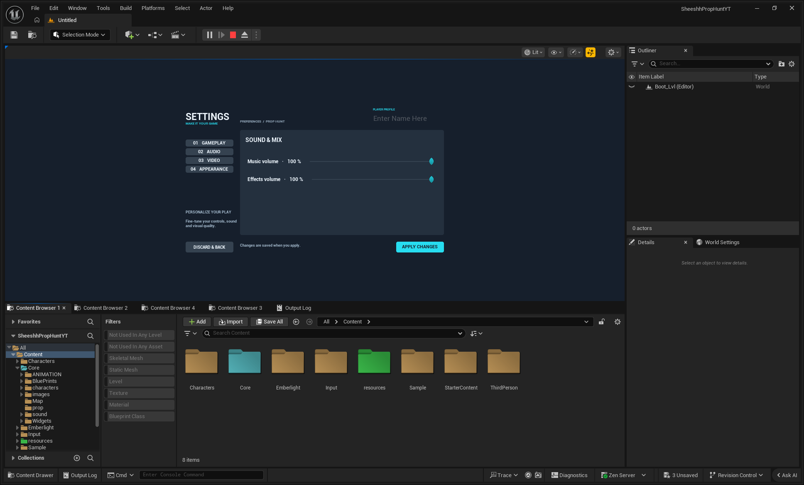
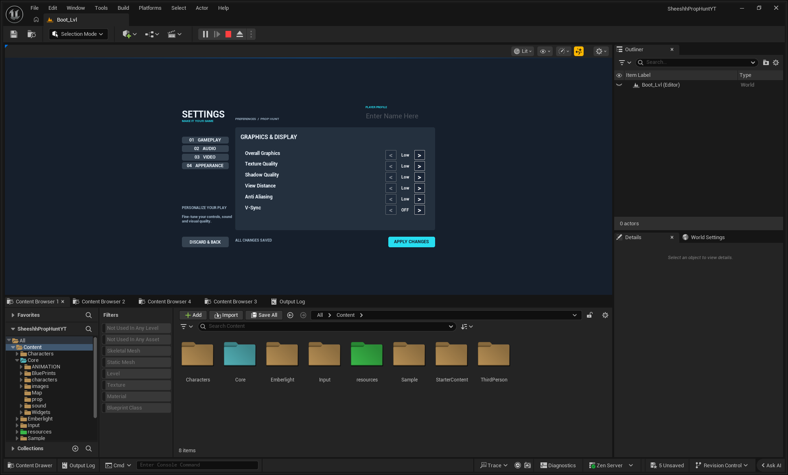
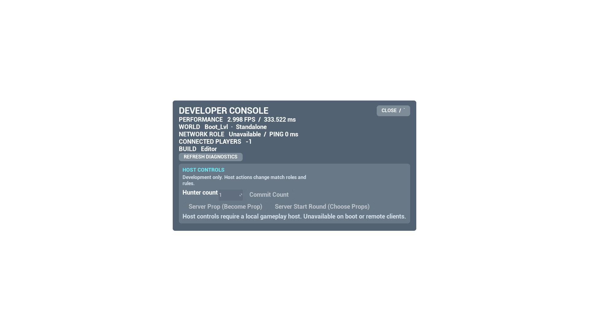
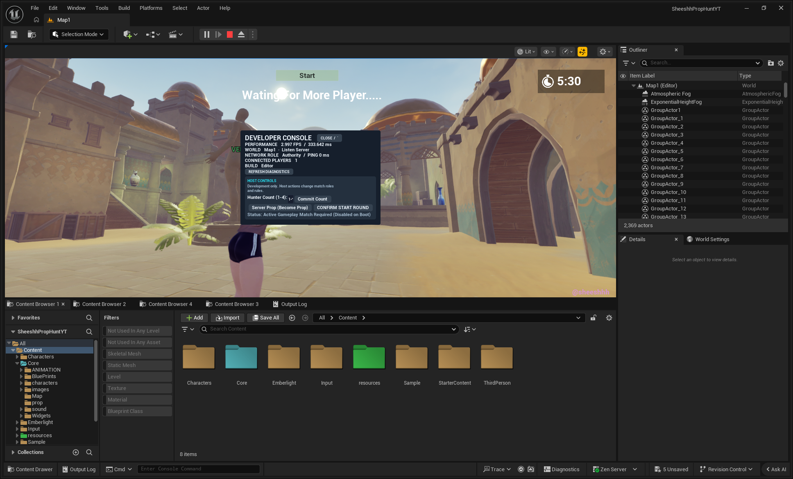
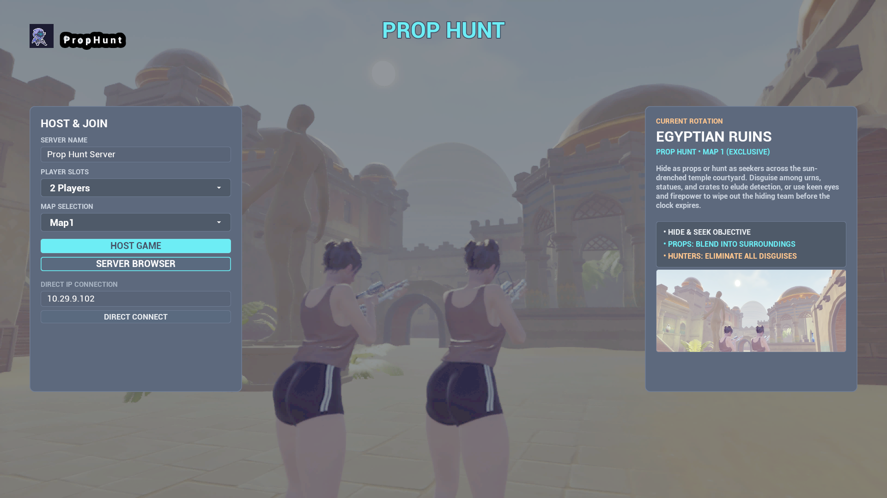
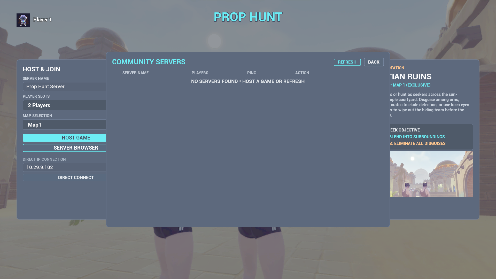
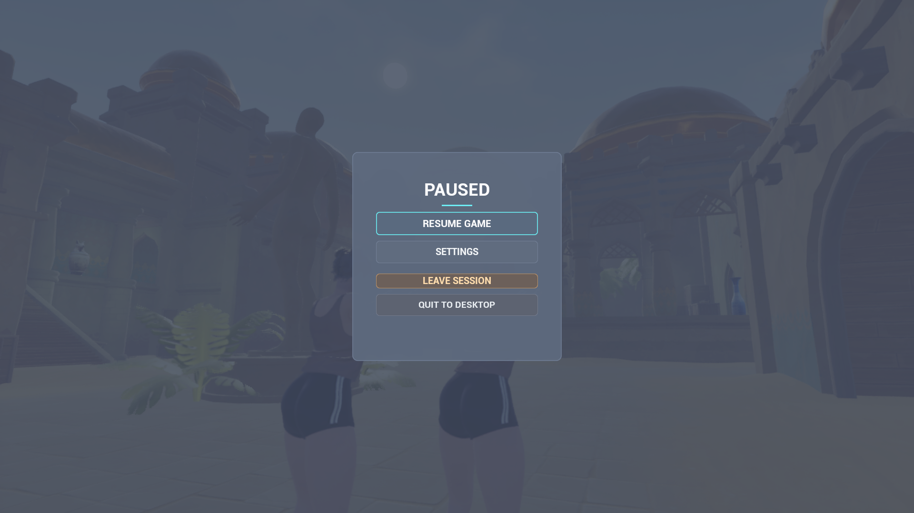

# Sheeshh Prop Hunt — Game Documentation

**Documentation Date:** 2026-10-12 (Asia/Calcutta)  
**Product Working Name:** Sheeshh Prop Hunt / `SheeshhPropHuntYT`  
**Engine & Target:** Unreal Engine 5.7 (`SheeshhPropHuntYTEditor`, Win64 Development)  
**Miro Board Companion:** [Sheeshh Prop Hunt — Game Documentation](MIRO_BOARD_INDEX.md)  

---

## 1. Contents

1. [Start Here & Overview](#2-start-here--overview)
2. [Feature & Status Matrix](#3-feature--status-matrix)
3. [Gameplay Rules & Roles](#4-gameplay-rules--roles)
4. [Player Journey & Screen Flow](#5-player-journey--screen-flow)
5. [Systems & Architecture](#6-systems--architecture)
6. [UI Gallery & Interaction Guide](#7-ui-gallery--interaction-guide)
7. [Developer Debug Tools](#8-developer-debug-tools)
8. [Settings & Save Data](#9-settings--save-data)
9. [Testing, Build & Setup Guide](#10-testing-build--setup-guide)
10. [Known Limitations & Evidence Gaps](#11-known-limitations--evidence-gaps)
11. [Roadmap & Scope Boundaries](#12-roadmap--scope-boundaries)
12. [Evidence & Curated Artifact Index](#13-evidence--curated-artifact-index)

---

## 2. Start Here & Overview

### 2.1 Game Pitch
**Sheeshh Prop Hunt** is an arcade multiplayer hide-and-seek action game built in Unreal Engine 5.7. Players are divided into two opposing teams:
- **Props**: Disguise themselves as everyday environmental objects (pots, crates, columns, pylons), freeze their orientation, taunt hunters with sound cues, and survive until the round timer expires.
- **Hunters**: Armed with hitscan weaponry, search the map to distinguish living props from static scenery, eliminating all hidden props before time runs out.

### 2.2 Documentation Discipline & Evidence Legend
To ensure absolute engineering clarity and avoid unverified assumptions, this documentation categorizes all systems using strict evidence standards:

| Status Tier | Meaning & Verification Standard |
| :--- | :--- |
| **USER-TESTED** | Behavior verified and accepted through interactive playtesting sessions by the project owner (e.g., core round lifecycle, hide/find loops). |
| **INDEPENDENTLY VERIFIED** | Validated via direct inspection, static code audits, automated editor checks, or reproducible test runs by Codex/Antigravity. |
| **REPORT-ONLY** | Historical assertions made in earlier task reports that have not undergone fresh independent end-to-end verification. |
| **PLANNED** | Approved future roadmap milestones (e.g., additional transformable props, dedicated internet matchmaking). |
| **EXCLUDED** | Explicitly removed from scope (e.g., Map2 and Map3 recovery). |
| **UNKNOWN / GAP** | Areas where runtime automation is absent, tests were skipped, or physical input has not been formally verified. |

---

## 3. Feature & Status Matrix

| System / Feature | Architectural Asset | Status Tier | Current Verified State & Evidence Notes |
| :--- | :--- | :--- | :--- |
| **Round Lifecycle & Timers** | `GM_ProphuntGameMode` | **USER-TESTED** | Timed hide/seek phases and win conditions verified by user playtesting. |
| **Prop Transform System** | `BP_propChar`, `BP_SPawnedProp` | **INDEPENDENTLY VERIFIED** | 55 prop catalog entries fully resolved. Prop mesh change verified. |
| **Hunter Weaponry & Aim** | `BP_ThirdPersonCharacter` | **INDEPENDENTLY VERIFIED** | Hitscan shooting, ammo consumption, and 4x mouse sensitivity response verified. |
| **Map Selection & Routing** | `Config/DefaultEngine.ini` | **INDEPENDENTLY VERIFIED** | Map1 (`Stylized_Egypt/Maps/Map1`) active; Map2/Map3 disabled and excluded. |
| **Online Subsystem (OSS)** | `Config/DefaultEngine.ini` | **INDEPENDENTLY VERIFIED** | Default OSS is `Null` (LAN/loopback). Steam OSS commented out; internet matchmaking unverified. |
| **Settings UI Redesign** | `WBP_MainMenu` | **INDEPENDENTLY VERIFIED** | Navy/slate palette, 6 video rows fit at 720p, live numeric readouts, dirty/discard state verified in PIE. |
| **Settings Persistence** | `BP_SettingsSaveGame` | **INDEPENDENTLY VERIFIED** | Audio/sensitivity values roundtrip through `BP_SettingsSaveGame`; graphics commits to `GameUserSettings`. |
| **Developer Debug Menu** | `WBP_DeveloperDebugPanel` | **INDEPENDENTLY VERIFIED** | Dynamic host gating (`IsDeveloperDebugAllowed` + Authority), live FPS/memory diagnostics, clamp hunter count. |
| **Session Teardown / Leave** | `WBP_Menu`, `MenuGameinstance` | **INDEPENDENTLY VERIFIED** | Clean `DestroySession` teardown and return to boot verified in PIE (P010-R1). |
| **Physical Keyboard / Focus** | Slate / PlayerInput | **UNKNOWN / GAP** | Tilde toggle route and F10 console mapped; physical hardware key acceptance requires manual sign-off. |
| **Packaged Build Acceptance** | Win64 Shipping | **REPORT-ONLY** | Clean cook/build passed historically in P009; no fresh packaged execution of latest UI redesign. |
| **Background Music Asset** | `SC_BackgroundMusic` | **UNKNOWN / GAP** | Audio class routing wired; specific music asset restoration pending user decision. |

---

## 4. Gameplay Rules & Roles

### 4.1 Prop Team
- **Objective**: Survive until the round timer runs out without being eliminated.
- **Transformation (`IA_ChangeProp`)**: Aim at an eligible environmental static mesh and interact to assume its appearance and collision bounds.
- **Rotation Lock (`IA_RotationLock`)**: Freeze the mesh rotation in place to blend seamlessly into walls, corners, or tables while freely panning the third-person camera.
- **Taunts (`IA_Taunt`)**: Emit audio cues (e.g., cat meows, robotic taunts, chuckles) to gain bonus survival score or bait hunters into mistakes.
- **Sensitivity Handling**: Aim sensitivity directly wired to `BP_SettingsSaveGame` camera sensitivity, matching Hunter input responsiveness.

### 4.2 Hunter Team
- **Objective**: Identify, track down, and eliminate all disguised props before round expiration.
- **Weaponry (`IA_shoot`)**: Fire hitscan shots. Firing penalties or health deductions on missed shots discourage mindless spraying.
- **Mobility (`IA_Move`, `IA_Look`, `IA_Jump`)**: Responsive third-person traversal across Map1's multi-level Egyptian courtyard architecture.

### 4.3 Round Flow & Win Conditions
1. **Waiting / Warmup**: Players connect and populate the lobby. Debug panel permits authoritative host to force-start.
2. **Hiding Phase**: Props are given a head start to disperse and transform; hunters are blinded or confined to the spawn room.
3. **Seeking Phase**: Hunters hunt props across the map.
4. **Resolution**:
   - **Prop Victory**: At least one prop remains alive when the round clock reaches `00:00`.
   - **Hunter Victory**: All props are destroyed before time expires.

---

## 5. Player Journey & Screen Flow

```
[Game Launch]
      │
      ▼
[Boot_Lvl] ──► [WBP_MainMenu]
                    │
       ┌────────────┼────────────┬────────────────────────┐
       ▼            ▼            ▼                        ▼
  [Host Game]  [Server Browser] [Settings]             [Quit Game]
       │            │            │
       │            ▼            ├─ Video (DX12/Foliage/Shadows/VSync)
       │       [Join Session]    ├─ Audio (Master/Music/SFX + %)
       │            │            ├─ Controls (Sensitivity Readout)
       │            │            └─ Apply / Discard / Dirty State
       ▼            ▼
  [Travel to Map1 (Listen Server)]
       │
       ▼
 [Gameplay Match] ◄── [WBP_DeveloperDebugPanel] (~ Tilde key, Host-only tools)
       │
       ▼
   [Pause Menu (Esc)] ──► [Leave Session] ──► [DestroySession] ──► [Return to Boot_Lvl]
```

### 5.1 Observed vs. Intended Navigation Paths
- **Observed Paths**:
  - Direct Host travel from `WBP_MainMenu` loads `Map1` as listen server.
  - Server browser queries LAN sessions via Null OSS and populates `WBP_Server` rows.
  - In-game Pause (`WBP_Menu`) exposes Resume, Settings, and Leave Session with confirmation dialogs.
  - Developer Debug panel (`WBP_DeveloperDebugPanel`) opens via `ToggleDeveloperDebug` (Tilde key / Backtick) or UI buttons.
- **Intended Future Paths**:
  - Worldwide matchmaking and Steam friend invites (currently dormant under Null OSS).
  - Post-match dedicated scoreboard and map voting screen.

---

## 6. Systems & Architecture

### 6.1 Core Architectural Components

```
                   ┌───────────────────────────────────┐
                   │        MenuGameinstance           │
                   │   (Persistent Session Layer)      │
                   └─────────────────┬─────────────────┘
                                     │
           ┌─────────────────────────┴─────────────────────────┐
           ▼                                                   ▼
┌───────────────────────────┐                       ┌───────────────────────────┐
│        Boot_Lvl           │                       │           Map1            │
│   (Entry Map & Menus)     │                       │     (Active Match)        │
└──────────┬────────────────┘                       └─────────────┬─────────────┘
           │                                                      │
           ▼                                                      ▼
┌───────────────────────────┐                       ┌───────────────────────────┐
│       WBP_MainMenu        │                       │    GM_ProphuntGameMode    │
│  (Host/Browser/Settings)  │                       │  (Rules/Timers/Hunter Lmt)│
└───────────────────────────┘                       └─────────────┬─────────────┘
                                                                  │
                                      ┌───────────────────────────┴───────────────────────────┐
                                      ▼                                                       ▼
                          ┌───────────────────────────┐                       ┌───────────────────────────┐
                          │BP_ThirdPersonPlayerContr. │                       │   WBP_DeveloperDebugPanel │
                          │ (Debug Singleton & Input) │                       │  (Diagnostics & Host Tools│
                          └─────────────┬─────────────┘                       └───────────────────────────┘
                                        │
                    ┌───────────────────┴───────────────────┐
                    ▼                                       ▼
        ┌───────────────────────┐               ┌───────────────────────┐
        │BP_ThirdPersonCharacter│               │      BP_propChar      │
        │   (Hunter Gameplay)   │               │    (Prop Gameplay)    │
        └───────────────────────┘               └───────────────────────┘
```

### 6.2 Asset Inventory & Roles

| Class / Asset Name | Path | Purpose & Responsibilities |
| :--- | :--- | :--- |
| `MenuGameinstance` | `/Game/Core/Map/MenuGameinstance` | Owns session creation, search, join, and teardown lifecycles. |
| `GM_ProphuntGameMode`| `/Game/Core/BluePrints/GM_ProphuntGameMode` | Server-authoritative match rules, seeker limits, round timers, and spawn assignments. |
| `BP_ThirdPersonPlayerController` | `/Game/Core/BluePrints/BP_ThirdPersonPlayerController` | Local player input, singleton debug panel management, cursor visibility restoration. |
| `BP_ThirdPersonCharacter` | `/Game/Core/BluePrints/BP_ThirdPersonCharacter` | Hunter pawn with hitscan fire, third-person movement, and sensitivity binding. |
| `BP_propChar` | `/Game/Core/BluePrints/BP_propChar` | Prop pawn with mesh transformation, rotation lock, taunt audio, and sensitivity aiming. |
| `BP_SPawnedProp` | `/Game/Core/BluePrints/BP_SPawnedProp` | Static mesh replication actor spawned when prop changes disguise. |
| `WBP_MainMenu` | `/Game/Core/Widgets/MainMenu/UI/WBP_MainMenu` | Main navigation, server browser, and redesigned multi-tab Settings menu. |
| `WBP_DeveloperDebugPanel` | `/Game/Core/Widgets/WBP_DeveloperDebugPanel` | Shipping-gated developer diagnostics and server host gameplay tools. |
| `WBP_Menu` | `/Game/Core/Widgets/WBP_Menu` | Pause menu with Resume, Settings, and Leave Game Session flows. |
| `BP_SettingsSaveGame`| `/Game/Core/Widgets/MainMenu/Data/BP_SettingsSaveGame` | SaveGame object serializing audio volumes, sensitivity, and player preferences to disk. |
| `UDebugMenuLib` | `Source/SheeshhPropHuntYT/Public/DebugMenuLib.h` | C++ Blueprint Function Library providing compile-time Shipping guards and hardware telemetry. |

### 6.3 Online Subsystem Configuration
- **Active Provider**: `DefaultPlatformService=Null` in `Config/DefaultEngine.ini`.
- **Network Driver**: `SteamNetDriver` declared in `NetDriverDefinitions` with fallback to `IpNetDriver`.
- **Reality**: Steam settings are commented out in INI files. Multiplayer operates over local LAN / IP loopback. Internet discovery requires explicit Steam OSS activation in future milestones.

---

## 7. UI Gallery & Interaction Guide

### 7.1 Current Live Settings — Audio & Controls

*Figure 7.1: Current live Settings panel captured in PIE. Features navy/slate card hierarchy, cyan accents, live float readout (`1.00`), percentage volume indicators (`100%`), and persistent Apply/Discard footer.*
- **File**: `coordination/evidence/Codex-settings-live.png`
- **Provenance**: Live PIE capture (Direct Codex takeover, Task P013-R3)
- **SHA256**: `5158BDEB9F46967C4FACD3B3030ECD0E88BB996B9EAC587E9ED4A624B0F5FD83`

### 7.2 Current Live Settings — Video & Graphics

*Figure 7.2: Current live Video settings captured in PIE. Demonstrates responsive scaling where all six graphics quality rows fit cleanly within a 720p viewport without clipping.*
- **File**: `coordination/evidence/Codex-settings-video-live.png`
- **Provenance**: Live PIE capture (Direct Codex takeover, Task P013-R3)
- **SHA256**: `7D0DBA5DE7B833E5381F3D68D760E1002364BE1B4247EAB403D60C977B06CD5A`

### 7.3 Developer Debug Panel — Final Layout

*Figure 7.3: Developer Debug Panel designer preview at 1080p. Displays live hardware telemetry, map info, network role, hunter limits, and host-only action controls.*
- **File**: `coordination/evidence/Codex-debug-1920-preview.png`
- **Provenance**: Asset preview (Task P013-R3)
- **SHA256**: `B518C25100D9C74015E1759BD83EA0E5771A3FA92C95B231C618E6F9F9A21E2F`

### 7.4 Developer Debug Panel — Live Host Context

*Figure 7.4: Historical live PIE runtime capture of the Developer Debug panel in active gameplay context.*
- **File**: `coordination/evidence/Codex-debug-live.png`
- **Provenance**: Historical live capture within takeover (Task P013-R3)
- **SHA256**: `0093D95FFCF437691264A276A97578034513B5AD4041148B17FC284AC21FF093`

### 7.5 Main Menu Presentation (Historical)

*Figure 7.5: Historical main menu presentation asset preview from Task P011-R2.*
- **File**: `coordination/evidence/P011-R2-menu-1080p.png`
- **Provenance**: Historical asset preview (Task P011-R2)
- **SHA256**: `C874F6FF5B9730E83EEFB19E2828427B639E26F3E9139D19D7EC96B844320C5D`

### 7.6 Server Browser Presentation (Historical)

*Figure 7.6: Historical server browser presentation asset preview from Task P011-R2.*
- **File**: `coordination/evidence/P011-R2-browser-1080p.png`
- **Provenance**: Historical asset preview (Task P011-R2)
- **SHA256**: `65E658F6A87C9B62C95E8B92FA08464F518531D27CF180FD932446BE88D106A5`

### 7.7 In-Game Pause & Leave Screen (Historical)

*Figure 7.7: Historical in-game pause screen from Task P010-R1 showing Leave Session option.*
- **File**: `coordination/evidence/P010-R1-pause-menu-1080p.png`
- **Provenance**: Historical capture (Task P010-R1)
- **SHA256**: `205D6DE7FACE70088BDA4E2C28CEBB204090C63E399A6B5DA136DF0A49E9FAA6`

---

## 8. Developer Debug Tools

### 8.1 Architectural Intent
The Developer Debug Panel (`WBP_DeveloperDebugPanel`) is strictly an internal diagnostic and QA tool. It is **not** a player-facing options menu.

### 8.2 Security & Authority Gating
1. **Compile-Time Shipping Guard**: C++ method `UDebugMenuLib::IsDeveloperDebugAllowed()` returns `false` unconditionally in Shipping builds (`UE_BUILD_SHIPPING == 1`), compiling out access entirely.
2. **Dynamic Host Authority Restrictions**:
   - Gated to local authoritative player controllers (`GetPlayerController()->HasAuthority()`).
   - Blocked on `Boot_Lvl` or when running as a remote client.
   - Status text explicitly reports: `"Disabled: Active gameplay match required on server host"` when unavailable.
3. **Control Actions**:
   - `Btn_CommitHunterCount`: Sets maximum hunter count clamped strictly between `1` and `TotalPlayers - 1`.
   - `Btn_ServerPropAction`: Authoritatively transforms the host pawn into `BP_propChar`.
   - `Btn_ServerHunterAction`: Transforms the host pawn into hunter character.
   - `Btn_StartRound`: Requires a two-step confirmation click to prevent accidental triggers; disables once match has begun.

### 8.3 Singleton Management & Input Restoration
- Managed as a singleton via `BP_ThirdPersonPlayerController`.
- Toggling the panel stores the prior Slate cursor visibility and input mode, restoring them cleanly upon close.

---

## 9. Settings & Save Data

### 9.1 Data Architecture
- **SaveGame Persistence**: Audio volumes and camera sensitivity are serialized via `BP_SettingsSaveGame.uasset` to local disk slot `settings.sav`.
- **GameUserSettings**: Graphical options (resolution, window mode, foliage, shadows, textures, post-processing, anti-aliasing, VSync) interface directly with Unreal's native `UGameUserSettings`.

### 9.2 Transactional Apply / Discard Cycle
1. Sliders cache baseline values upon panel construction or successful commit.
2. Moving sliders triggers live dirty state flags and updates numeric percentage readouts.
3. Clicking **Discard** rolls back all sliders and GameUserSettings back to last-committed values.
4. Clicking **Apply** commits values to disk and propagates sensitivity directly to active `BP_ThirdPersonCharacter` and `BP_propChar` pawns.

---

## 10. Testing, Build & Setup Guide

### 10.1 Engine Prerequisites
- **Unreal Engine 5.7**: Installed with Win64 target.
- **Visual Studio 2022**: MSVC v143, Windows 10/11 SDK.

### 10.2 PowerShell Editor Build Pattern
```powershell
# Resolve UE 5.7 root directory (example):
$ueRoot = "C:\Program Files\Epic Games\UE_5.7"

# Execute native build batch file:
& "$ueRoot\Engine\Build\BatchFiles\Build.bat" SheeshhPropHuntYTEditor Win64 Development "-Project=$PWD\SheeshhPropHuntYT.uproject" -WaitMutex
```

### 10.3 Play-In-Editor (PIE) Multiplayer Testing Procedure
1. Open `SheeshhPropHuntYT.uproject` in Unreal Editor 5.7.
2. Open `/Game/Core/Map/Boot_Lvl.umap`.
3. In Editor Play settings:
   - Set **Number of Players** to `2`.
   - Set **Net Mode** to `Play As Listen Server`.
4. Click **Play**:
   - **Server Window**: Click *Host Game* -> loads `Map1`. Press `~` to verify Debug host tools are enabled.
   - **Client Window**: Click *Find Game* -> select host session -> joins `Map1`. Press `~` to verify host tools are disabled with denial status.
5. In-Game: Press `Esc` -> select *Leave Session* -> verify clean teardown and return to `Boot_Lvl`.

---

## 11. Known Limitations & Evidence Gaps

1. **Physical Hardware Keyboard Acceptance**:
   - Backtick (`~`), `F10` console redirection, and exact Slate keyboard focus have verified graph execution routes in Blueprint, but automated native key strike automation is unavailable. Final hardware acceptance requires manual user sign-off.
2. **Fresh Packaged Shipping Validation**:
   - While UAT cook succeeded without errors in P009, the recent UI and Debug redesigns have been validated solely in Editor PIE. A fresh packaged Windows build test has not yet been executed.
3. **Player Name Access on Startup**:
   - Two-client startup logs occasionally note `BP_ThirdPersonCharacter::SetLocalPlayerName` accessing an uninitialized `PlayerState`. Non-fatal, but logged for future lifecycle cleanup.
4. **Subjective Audio Audibility**:
   - Sound classes (`SC_Master`, `SC_Music`, `SC_SFX`) and `SM_SettingsMix` volume multipliers are mathematically verified, but actual auditory output of missing background music requires user asset selection.

---

## 12. Roadmap & Scope Boundaries

### 12.1 Approved Next Steps
- **Map1 Transformable Props Expansion**: Populate Map1 with additional interactive props featuring distinct collision bounds.
- **Background Music Resolution**: Restore intended background track, replace with new royalty-free music, or intentionally remove based on user preference.
- **Steam Online Subsystem & Internet Matchmaking**: Separately scoped milestone to configure Steam AppID 480, lobby invitations, and NAT traversal.
- **Voice Chat (VOIP)**: Dedicated in-game spatial audio and team communications.

### 12.2 Strict Scope Exclusions
- **Map2 and Map3 Restoration**: Permanently excluded from project roadmap by user direction. All hosting is strictly routed to Map1.
- **Game Rule Reworks**: Core round rules and team structures remain fixed.

---

## 13. Evidence & Curated Artifact Index

All screenshots and reports are stored locally in the project repository:

| Asset Name | Relative File Path | SHA256 Hash |
| :--- | :--- | :--- |
| **Settings Audio Live** | `coordination/evidence/Codex-settings-live.png` | `5158BDEB9F46967C4FACD3B3030ECD0E88BB996B9EAC587E9ED4A624B0F5FD83` |
| **Settings Video Live** | `coordination/evidence/Codex-settings-video-live.png` | `7D0DBA5DE7B833E5381F3D68D760E1002364BE1B4247EAB403D60C977B06CD5A` |
| **Debug 1920 Preview** | `coordination/evidence/Codex-debug-1920-preview.png` | `B518C25100D9C74015E1759BD83EA0E5771A3FA92C95B231C618E6F9F9A21E2F` |
| **Debug Live Host** | `coordination/evidence/Codex-debug-live.png` | `0093D95FFCF437691264A276A97578034513B5AD4041148B17FC284AC21FF093` |
| **Historical Menu** | `coordination/evidence/P011-R2-menu-1080p.png` | `C874F6FF5B9730E83EEFB19E2828427B639E26F3E9139D19D7EC96B844320C5D` |
| **Historical Browser** | `coordination/evidence/P011-R2-browser-1080p.png` | `65E658F6A87C9B62C95E8B92FA08464F518531D27CF180FD932446BE88D106A5` |
| **Historical Pause** | `coordination/evidence/P010-R1-pause-menu-1080p.png` | `205D6DE7FACE70088BDA4E2C28CEBB204090C63E399A6B5DA136DF0A49E9FAA6` |
| **Takeover Report** | `coordination/archive/P013-R3-before-Miro-documentation_REPORT.md` | *Direct Codex Takeover Record* |
| **UI Hashes Record** | `coordination/evidence/Codex-UI-Takeover-hashes.json` | *8 changed assets baseline & final hashes* |

### 13.1 Future Screenshot Capture Checklist
When fresh packaged runs or manual playtests are conducted, capture the following target photos to complete the gallery:
1. `Map1-Courtyard-Overview.png`: High-angle beauty shot of Map1's main play area.
2. `Prop-Disguise-ThirdPerson.png`: Active prop character disguised as an Egyptian urn/crate with rotation locked.
3. `Hunter-HUD-Aiming.png`: Hunter POV with reticle aimed at suspected prop, displaying health and ammo counter.
4. `Match-Victory-Screen.png`: Round victory banner for Props or Hunters.
5. `Host-Client-Split-Comparison.png`: Side-by-side verification of replication fidelity.
